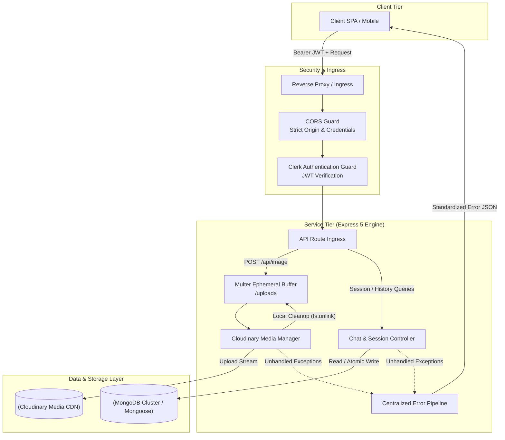
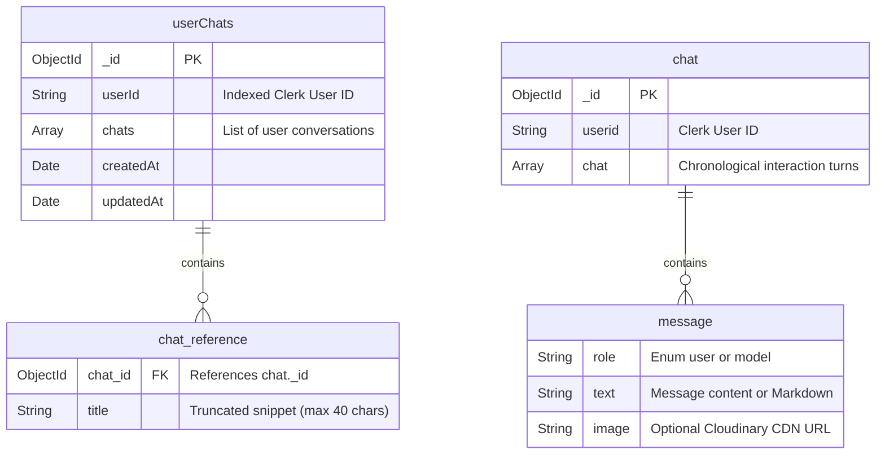

# Manga.ai Backend Core Service

An asynchronous, distributed-ready REST backend service built with **Node.js**, **Express 5**, **MongoDB/Mongoose**, **Clerk Auth**, and **Cloudinary**. Engineered for high-throughput conversation persistence, zero-trust session validation, and atomic media-metadata lifecycle management.

---

## 🏗️ System Architecture

The service operates as a stateless RESTful application tier responsible for conversation state synchronization, user chat indexing, and media processing.



---

## 💡 Engineering Highlights & Design Decisions

### 1. Document Partitioning Strategy (Mitigating the 16MB BSON Limit)
* **Problem:** In conversational applications, naively embedding all message logs inside the user's primary document leads to rapid document bloat, poor I/O latency, and eventually breaches MongoDB’s **16MB BSON document size constraint**.
* **Engineered Solution:** Separated into a decoupled two-collection design:
  - **`userChats` Collection:** Acts as an indexed lightweight metadata directory (`userId`, `chat_id`, `title`, and `timestamps`). Querying user history requires minimal memory overhead (`O(1)` document lookup without fetching megabytes of raw message history).
  - **`chat` Collection:** Dedicated conversation document indexed by `_id` and isolated per thread, storing the chronological interaction turns.

### 2. Atomic Conversation Append with Concurrency Control
* To preserve message sequencing and prevent race conditions when client state revalidates:
  - Utilizes MongoDB's `$push` with the `$each` modifier to perform atomic batch writes in a single round-trip:
    ```javascript
    await chatModel.findByIdAndUpdate(id, { $push: { chat: { $each: body } } });
    ```
  - Eliminates the need for client-side locking or expensive read-modify-write transactions for sequential message turns.

### 3. Ephemeral Buffer & Garbage-Collected Media Pipeline
* **Two-Phase Upload Lifecycle:**
  1. Files are intercepted by Multer into an isolated ephemeral local storage directory (`/uploads`) with a collision-resistant timestamp-entropy suffix (`Date.now() + Math.random()`).
  2. The buffer is uploaded to Cloudinary's global CDN inside the dedicated `chat-bot` namespace.
  3. **Synchronous File System Cleanup:** The local temp artifact is immediately unlinked (`fs.unlinkSync`) in the same execution cycle, preventing disk exhaustion and dangling file descriptors under high concurrency.

### 4. Zero-Trust Identity Integration
* Authentication is delegated to **Clerk** at the middleware boundary via `@clerk/express`.
* The server verifies the cryptographically signed session tokens and injects verified identity claims (`userId`) via `getAuth(req)`. Unauthenticated or forged requests are rejected before ever hitting the business logic or database layers.

### 5. Resilient Error Propagation & Express 5 Modern Pipeline
* Express 5 brings native asynchronous error handling, augmented by an explicit `asyncHandler` higher-order wrapper ensuring all rejected promises seamlessly route to the centralized `globalErrorHandler`.
* Prevents unhandled promise rejections from terminating the Node.js event loop, returning consistent error schemas across all API endpoints.

---

## 🗄️ Database Schemas & Data Model



---

## 📡 REST API Specification

### Authentication
All protected routes require an active Clerk session cookie or header verified via `clerkMiddleware()`.

---

### `POST /api/chat/new`
Initializes a new conversation thread and registers the thread reference in the user's directory.

* **Request Body:**
  ```json
  {
    "text": "Explain quantum computing fundamentals",
    "image": "https://res.cloudinary.com/.../image.jpg" // optional
  }
  ```
* **Response `(200 OK)`:**
  ```json
  {
    "success": true,
    "error": false,
    "id": "670c5b369c4a8a5f33d4e891",
    "message": "Chat saved"
  }
  ```

---

### `GET /api/chat/:id`
Fetches the full conversation message history for a specific thread ID.

* **URL Parameters:** `id` (MongoDB ObjectId)
* **Response `(200 OK)`:**
  ```json
  {
    "chats": [
      {
        "role": "user",
        "text": "Explain quantum computing fundamentals",
        "_id": "670c5b369c4a8a5f33d4e892"
      },
      {
        "role": "model",
        "text": "Quantum computing is a rapidly-emerging technology...",
        "_id": "670c5b379c4a8a5f33d4e893"
      }
    ]
  }
  ```

---

### `PATCH /api/chat/:id`
Appends one or more conversation turns to an existing chat document.

* **URL Parameters:** `id` (MongoDB ObjectId)
* **Request Body:** Array of message objects
  ```json
  [
    {
      "role": "user",
      "text": "Can you elaborate on superposition?"
    },
    {
      "role": "model",
      "text": "Superposition is a principle of quantum mechanics..."
    }
  ]
  ```
* **Response `(200 OK)`:**
  ```json
  {
    "success": true,
    "error": false
  }
  ```

---

### `GET /api/history`
Retrieves all historical chat sessions for the authenticated user to populate sidebar navigation.

* **Response `(200 OK)`:**
  ```json
  {
    "userChats": {
      "_id": "670c5aa19c4a8a5f33d4e88f",
      "userId": "user_2nAbC...",
      "chats": [
        {
          "chat_id": "670c5b369c4a8a5f33d4e891",
          "title": "Explain quantum computing fundamentals",
          "_id": "670c5b369c4a8a5f33d4e894"
        }
      ],
      "createdAt": "2026-10-14T06:30:00.000Z",
      "updatedAt": "2026-10-14T06:35:12.000Z"
    }
  }
  ```

---

### `POST /api/image`
Uploads a binary image file via `multipart/form-data`, persists it to Cloudinary, and removes local disk caches.

* **Headers:** `Content-Type: multipart/form-data`
* **Form Field:** `image: File`
* **Response `(200 OK)`:**
  ```json
  {
    "url": "https://res.cloudinary.com/demo/image/upload/v1234567890/chat-bot/sample.png",
    "public_id": "chat-bot/sample"
  }
  ```

---

### `DELETE /api/image/:id`
Deletes an uploaded image asset from Cloudinary storage.

* **URL Parameters:** `id` (Asset public ID)
* **Response `(200 OK)`:**
  ```json
  {
    "success": true
  }
  ```

---

## 🚀 Getting Started

### Prerequisites
* Node.js v18.x or later
* Active MongoDB connection URI
* Cloudinary and Clerk developer accounts

### Installation & Execution
```bash
# Install dependencies
npm install

# Start development server with hot-reload (Nodemon)
npm run dev

# Start production server
npm start
```

---
