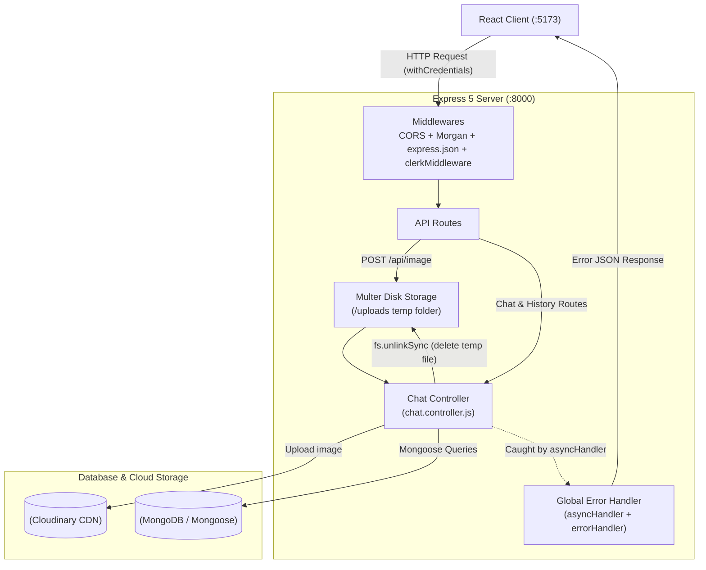
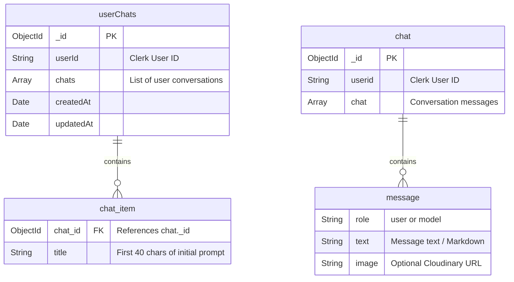

# Manga.ai — Backend API (`Api/`)

REST API built with **Node.js (ES Modules)**, **Express 5**, and **MongoDB (Mongoose)** for the Manga.ai chatbot application. It manages user chat history, conversation messages, Clerk session authentication, and image uploads via **Multer** and **Cloudinary**.

---

## 🏗️ Backend Architecture & Request Flow



---

## 💡 Key Implementation Details

### 1. Separate Collections for Sidebar History and Chat Messages
Instead of storing every conversation and all its messages inside a single user document, the database schema is split into two Mongoose models:
* **`userChats` ([`models/userChats.model.js`](./models/userChats.model.js)):** Stores only the user's `userId` and a lightweight array of `{ chat_id, title }`. When the frontend loads the sidebar (`GET /api/history`), it only fetches titles and IDs instead of pulling the full text of every past conversation.
* **`chat` ([`models/chat.model.js`](./models/chat.model.js)):** Stores the full array of `{ role, text, image }` messages for a single conversation thread, fetched only when the user opens `/chat/:id`.

### 2. Appending Messages with MongoDB `$push` and `$each`
When a conversation turn finishes on the frontend, `PATCH /api/chat/:id` appends both the user prompt and the AI response in a single database update rather than fetching the whole document into memory and re-saving it:
```javascript
export const addChat = async (req, res) => {
  const id = req.params.id;
  const body = req.body;
  await chatModel.findByIdAndUpdate(id, { $push: { chat: { $each: body } } });
  return res.status(200).json({ success: true, error: false });
};
```

### 3. Image Upload & Local Temp File Cleanup
Image uploads (`POST /api/image`) use a two-step flow:
1. **Multer ([`Middlewares/multer.js`](./Middlewares/multer.js))** saves the incoming `multipart/form-data` file temporarily to the local `uploads/` folder with a unique timestamp prefix (`Date.now() + "-" + Math.round(Math.random() * 1e9)`).
2. **`uploadImage` ([`Controllers/chat.controller.js`](./Controllers/chat.controller.js))** uploads the file to Cloudinary under the `chat-bot` folder, immediately removes the local temporary file using `fs.unlinkSync(image.path)` to keep the `uploads/` folder clean, and returns the Cloudinary `url` and `public_id`.

### 4. Centralized Async Error Handling
All route controllers are wrapped with [`asyncHandler.js`](./Middlewares/asyncHandler.js):
```javascript
export const asyncHandler = (func) => (req, res, next) =>
  Promise.resolve(func(req, res)).catch(next);
```
Any database or Cloudinary error thrown inside an `async` controller is automatically passed to [`globalErrorHandler.js`](./Middlewares/globalErrorHandler.js), which logs the error stack and returns a consistent JSON response.

### 5. Clerk Authentication Integration
The server uses `@clerk/express` (`clerkMiddleware()`) along with `cors({ origin: process.env.FRONTEND_URI, credentials: true })` to read Clerk session cookies sent from the React frontend and extract the logged-in `userId` via `getAuth(req)`.

---

## 🗄️ Database Schema



---

## 📂 Folder Structure

```text
Api/
├── Config/
│   └── dbConnect.js             # Mongoose connection setup
├── Controllers/
│   └── chat.controller.js       # Route handlers for chats, history, and images
├── Middlewares/
│   ├── asyncHandler.js          # Promise wrapper for async route handlers
│   ├── globalErrorHandler.js    # Express error-handling middleware
│   └── multer.js                # Multer diskStorage configuration
├── models/
│   ├── chat.model.js            # Schema for individual conversation messages
│   └── userChats.model.js       # Schema for a user's list of chats
├── uploads/                     # Temporary folder for Multer uploads
├── .env.example                 # Environment variable template
├── package.json
└── server.js                    # Express app entry point & route definitions
```

---

## 📡 API Endpoints

| Method | Endpoint | Description |
| :--- | :--- | :--- |
| `POST` | `/api/chat/new` | Creates a new chat document and adds its ID & title (first 40 chars) to `userChats`. |
| `GET` | `/api/chat/:id` | Returns the `chats` message array for a specific conversation ID. |
| `PATCH` | `/api/chat/:id` | Appends an array of new message objects (`{ role, text, image }`) to an existing chat. |
| `GET` | `/api/history` | Returns the `userChats` document for the currently authenticated Clerk user. |
| `POST` | `/api/image` | Uploads an image file (`multipart/form-data`, field `image`) to Cloudinary and deletes the local temp file. |
| `DELETE` | `/api/image/:id` | Deletes an uploaded image from the `chat-bot/` folder in Cloudinary by its ID. |

---

## ⚙️ Environment Variables

Create an `.env` file in the `Api/` directory (see [`.env.example`](./.env.example)):

```ini
FRONTEND_URI=http://localhost:5173
MONGODB_URi=mongodb+srv://<username>:<password>@cluster.mongodb.net/chatbot

# Clerk Auth
CLERK_PUBLISHABLE_KEY=pk_test_...
CLERK_SECRET_KEY=sk_test_...

# Cloudinary
CLOUD_NAME=your_cloud_name
CLOUD_API_KEY=your_cloudinary_api_key
CLOUD_SECRETE_KEY=your_cloudinary_api_secret
```

---

## 🚀 Running Locally

```bash
# Install dependencies
npm install

# Run in development mode with nodemon (runs on port 8000)
npm run dev

# Run in production mode
npm start
```

---

## 🔧 Next Steps & Planned Improvements

* **Strict Route Ownership Checks:** Enforce Clerk's `requireAuth()` middleware across all routes and verify that `chat.userid === userId` inside `getChats` and `addChat` so users can only access their own conversations.
* **Database Indexing:** Add `{ index: true }` on `userId` in `userChats.model.js` for faster queries as the user base grows.
* **Move Gemini Calls to the Backend:** Proxy Gemini streaming through an Express Server-Sent Events (SSE) endpoint so the Gemini API key stays strictly on the server.
* **Safe Temp File Cleanup:** Move `fs.unlinkSync` into a `try / finally` block so temporary files in `uploads/` are deleted even if a Cloudinary upload fails.
