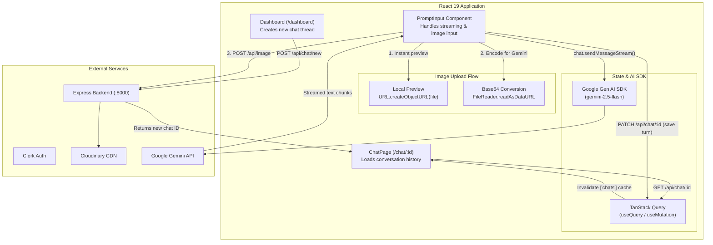

# Manga.ai — Frontend Client (`Client/`)

React frontend for **Manga.ai**, built with **React 19**, **Vite 7**, **TanStack Query v5**, **React Router v7**, **Clerk Auth**, and the **Google Gen AI SDK (`@google/genai`)**. It supports multi-turn conversations with `gemini-2.5-flash`, real-time streamed Markdown responses, and image uploads for multimodal prompts.

---

## 🏗️ Client Architecture & Data Flow



---

## 💡 Key Implementation Details

### 1. Streaming Responses with `@google/genai`
Instead of waiting for the full AI response before updating the UI, [`PromptInput.jsx`](./src/components/newPrompt/PromptInput.jsx) uses `chat.sendMessageStream()` and iterates over incoming chunks with a `for await...of` loop. As each chunk arrives, React state is updated and rendered through `react-markdown`:

```javascript
const stream1 = await chat.sendMessageStream({
  message: image.aiData ? [image.aiData, text] : text,
});
let answerAcc = "";
setIsLoading(false);
for await (const chunk of stream1) {
  answerAcc += chunk.text;
  setAnswer(answerAcc);
}
```

### 2. Multi-Turn Context Initialization
When a user opens an existing chat in [`ChatPage.jsx`](./src/Pages/chatPage/ChatPage.jsx), previous messages are fetched from MongoDB and mapped into the `{ role, parts: [{ text }] }` format expected by `@google/genai`. [`utils/responseGeneration.js`](./utils/responseGeneration.js) initializes the `gemini-2.5-flash` chat session with that history and applies safety settings for harassment and hate speech.

### 3. Handling Images for Both Gemini and MongoDB
When a user selects an image in [`PromptInput.jsx`](./src/components/newPrompt/PromptInput.jsx) (`handleUpload`):
1. **Instant Preview:** Creates a local object URL (`URL.createObjectURL(file)`) so the user immediately sees the selected image in the input bar with a loading spinner while it uploads.
2. **Base64 Encoding for Gemini:** Uses the browser's `FileReader` API to convert the file into Base64 (`inlineData: { data, mimeType }`) so it can be passed directly into `chat.sendMessageStream()`.
3. **Cloudinary Upload for History:** Uploads the file via `POST /api/image` to Cloudinary (`imageAdd` mutation). If the user clicks the close button before sending, `DELETE /api/image/:id` removes it from Cloudinary. Once the streamed response finishes, the Cloudinary URL is saved alongside the message in MongoDB.

### 4. Preventing Duplicate Calls on New Chats (`useRef` Guard)
When a user starts a new chat from the Dashboard, the initial message is saved to the database first and the router navigates to `/chat/:id` with `chatHistory.length === 1`. To automatically generate the AI response for that first message without firing twice under React 19's `StrictMode` double-mount in development, a `useRef` flag (`hasRun`) guards the effect:

```javascript
const hasRun = useRef(false);
useEffect(() => {
  if (!hasRun.current) {
    if (chatHistory?.length == 1) {
      setIsLoading(true);
      streamOutput(chatHistory[0]?.parts[0]?.text);
    }
  }
  hasRun.current = true;
}, [chatHistory]);
```

### 5. Server State & Cache Invalidation with TanStack Query
All API calls in [`Api/api.js`](./Api/api.js) are managed through `@tanstack/react-query`:
* **Sidebar History ([`RecentChats.jsx`](./src/components/RecentChats/RecentChats.jsx)):** Uses `useQuery({ queryKey: ["userChats"] })`. Creating a new chat on the Dashboard invalidates `["userChats"]` so the new thread appears in the sidebar automatically.
* **Active Chat ([`ChatPage.jsx`](./src/Pages/chatPage/ChatPage.jsx)):** Uses `useQuery({ queryKey: ["chats", id] })`. When a streamed response completes and `PATCH /api/chat/:id` succeeds, invalidating `["chats"]` refreshes the message list from the database and clears the temporary streaming state.

### 6. Layout Hierarchy & Protected Routes
Routing in [`main.jsx`](./src/main.jsx) uses `createBrowserRouter` with two nested layouts:
* **[`RootLayout.jsx`](./src/Layouts/RootLayout/RootLayout.jsx):** Wraps the application with `ContextProvider`, `QueryClientProvider`, and `ClerkProvider`, and renders the top header.
* **[`DashboardLayout.jsx`](./src/Layouts/DashboardLayout/DashboardLayout.jsx):** Protects `/dashboard` and `/chat/:id`. It checks `useAuth()` from `@clerk/clerk-react`, shows a Material-UI `CircularProgress` spinner while Clerk loads, and redirects unauthenticated users to `/login`.

---

## 📂 Folder Structure

```text
Client/
├── Api/
│   └── api.js                        # Axios instance (withCredentials: true) & API helper functions
├── src/
│   ├── assets/                       # Icons, logos, and landing page images
│   ├── components/
│   │   ├── chatList/                 # Sidebar navigation links
│   │   ├── DashInput/                # Prompt input bar for the Dashboard page
│   │   ├── newPrompt/                # Chat prompt input, image upload & streaming logic
│   │   ├── RecentChats/              # Fetches and renders user's recent chat links
│   │   └── Upload/                   # File input button component
│   ├── context/                      # React Context setup
│   ├── Layouts/
│   │   ├── DashboardLayout/          # Auth check wrapper + sidebar layout
│   │   └── RootLayout/               # Providers (Clerk, React Query) + top navbar
│   ├── Pages/
│   │   ├── chatPage/                 # Conversation view (/chat/:id)
│   │   ├── dashboard/                # New chat creation page (/dashboard)
│   │   ├── homePage/                 # Landing page (/) with react-type-animation
│   │   ├── login/                    # Clerk <SignIn /> page (/login/*)
│   │   └── signUp/                   # Clerk <SignUp /> page (/signUp/*)
│   └── main.jsx                      # App entry point & router configuration
├── utils/
│   └── responseGeneration.js         # GoogleGenAI setup & gemini-2.5-flash config
├── .env.example                      # Environment variable template
├── package.json
└── vite.config.js
```

---

## ⚙️ Environment Variables

Create an `.env` file in the `Client/` directory (see [`.env.example`](./.env.example)):

```ini
VITE_CLERK_PUBLISHABLE_KEY=pk_test_...
VITE_API_URI=http://localhost:8000
VITE_GEMINI_API_KEY=AIzaSy...
```

---

## 🚀 Running Locally

```bash
# Install dependencies
npm install

# Start Vite dev server (http://localhost:5173)
npm run dev

# Build for production
npm run build

# Preview production build
npm run preview
```

---

## 🔧 Next Steps & Planned Improvements

* **Move Gemini SDK Calls to the Backend:** Currently `VITE_GEMINI_API_KEY` is called from the browser for direct streaming. Moving this to a backend streaming endpoint will keep the API key private.
* **Support Image Upload on Initial Dashboard Prompt:** Extend `DashboardInput.jsx` so images selected on `/dashboard` are uploaded and included in the first message of a new chat, matching `PromptInput.jsx`.
* **Include Previous Images in Multi-Turn History:** Pass historical image data (or file references) when initializing `getAiChat(chatHistory)` so follow-up questions can reference images from earlier turns.
