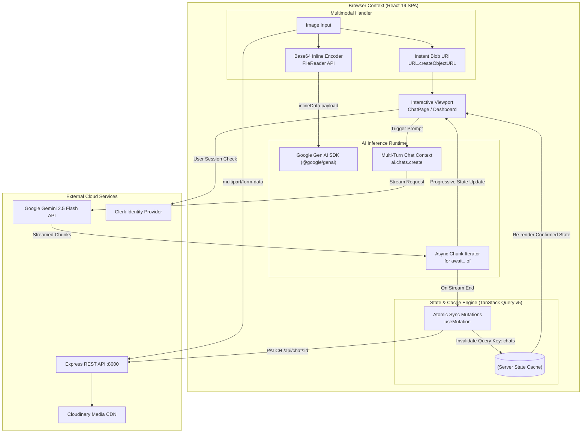

# Manga.ai Web Client

A modern, high-performance conversational AI interface built with **React 19**, **Vite 7**, **TanStack Query v5**, **Google Gen AI SDK v1.20 (`gemini-2.5-flash`)**, and **Clerk Identity**. Engineered for real-time token streaming, zero-latency multimodal media pipelines, and robust declarative server-state synchronization.

---

## 🏗️ Client Architecture & Information Flow

The frontend coordinates asynchronous token streaming directly from generative foundation models while decoupling server-side persistence through transactional REST mutations.



---

## 💡 Engineering Highlights & Key Technical Decisions

### 1. Dual-Path Zero-Latency Multimodal Ingestion
* **The Problem:** In conventional AI web clients, users must wait for an image to fully upload to remote cloud storage before the LLM can receive the image URL and begin generating a response. This introduces noticeable latency (often 1.5–3 seconds of dead wait time).
* **Engineered Solution:** Designed a bifurcated, parallel ingestion pipeline:
  1. **Instant UI Feedback:** Generates an ephemeral in-memory URL via `URL.createObjectURL(file)` to render the image preview immediately with zero layout shift.
  2. **Direct Gemini Vision Stream:** Uses the browser’s `FileReader` API to extract a Base64 binary payload formatted into Gemini’s native `inlineData` structure (`{ mimeType, data }`). This is passed directly into `chat.sendMessageStream()`, enabling inference to start without waiting for third-party uploads.
  3. **Non-Blocking Persistence:** Concurrently streams the raw file to the Express backend (`POST /api/image`) $\rightarrow$ Cloudinary CDN to acquire an immutable CDN URL for MongoDB storage once the session turn completes.

### 2. High-Throughput Token Streaming with Asynchronous Iterables
* Rather than waiting for full-body server responses, the client leverages native **ES2018 Async Iterables** (`for await...of`) to consume token chunks emitted by Gemini’s WebSocket/HTTP/2 streaming layer:
  ```javascript
  const stream = await chat.sendMessageStream({ message: payload });
  let accumulated = "";
  for await (const chunk of stream) {
    accumulated += chunk.text;
    setAnswer(accumulated); // Progressive React state re-render
  }
  ```
* Combined with `react-markdown`, formatted responses (headers, markdown tables, lists, and syntax blocks) compile progressively as tokens arrive.

### 3. React 19 StrictMode Concurrency Guard
* **The Problem:** React 19’s Strict Mode deliberately executes mounting effects twice in development to identify side-effect leaks. When navigating from the Dashboard with an initial prompt, a naive `useEffect` triggers double LLM generations, wasting token quota and generating duplicate answers.
* **Engineered Solution:** Implemented an explicit execution fence using an un-rendered reference sentinel (`hasRun = useRef(false)`):
  ```javascript
  const hasRun = useRef(false);
  useEffect(() => {
    if (!hasRun.current) {
      if (chatHistory?.length === 1) {
        streamOutput(chatHistory[0]?.parts[0]?.text);
      }
    }
    hasRun.current = true;
  }, [chatHistory]);
  ```
  Guarantees strict single-execution semantics during concurrent root reconciliation.

### 4. Declarative Server State Synchronization (TanStack Query v5)
* Decoupled UI state from raw network requests by relying on TanStack Query:
  - **Deduplication & Cache Isolation:** Dynamic conversation threads are partitioned under unique query keys (`["chats", id]`), preventing stale cross-chat leaks.
  - **Predictable Cache Invalidation:** Successful chat appends trigger targeted cache invalidations (`queryClient.invalidateQueries(["chats"])` and `["userChats"]`), maintaining instant consistency between the chat viewport and sidebar directory without manual state prop-drilling.

### 5. Architectural Guardrails: Route Isolation & Defensive Auth
* Implemented nested layout wrappers via `react-router-dom` v7:
  - **`RootLayout`:** Instantiates top-level context providers (`ContextProvider`, `QueryClientProvider`, `ClerkProvider`) and persistent branding header.
  - **`DashboardLayout`:** Enforces defensive authentication guards using Clerk's `useAuth()` hook. Unauthenticated sessions are intercepted before component instantiation and redirected to `/login`, while rendering accessible loading fallbacks during token verification.

---

## 📂 Project Organization

```
Client/
├── src/
│   ├── assets/              # Static vector and image assets
│   ├── components/
│   │   ├── chatList/        # Navigation sidebar & route links
│   │   ├── DashInput/       # Dashboard initial prompt dispatcher
│   │   ├── newPrompt/       # Core streaming input & media controller (PromptInput.jsx)
│   │   ├── RecentChats/     # TanStack Query reactive conversation history
│   │   └── Upload/          # Pure file selector abstraction
│   ├── context/             # Global React Context provider
│   ├── Layouts/
│   │   ├── DashboardLayout/ # Protected layout with auth guard & sidebar split
│   │   └── RootLayout/      # Root provider tree & global navigation header
│   ├── Pages/
│   │   ├── chatPage/        # Dynamic multi-turn chat viewport (/chat/:id)
│   │   ├── dashboard/       # New chat dashboard & quick suggestion cards
│   │   ├── homePage/        # Branded marketing landing page with interactive typing demo
│   │   ├── login/           # Clerk SSO login wrapper
│   │   └── signUp/          # Clerk signup wrapper
│   ├── App.css / index.css  # Modern dark-mode stylesheets
│   └── main.jsx             # React 19 root mount & router hierarchy
├── utils/
│   └── responseGeneration.js# Google Gen AI client instantiation & safety policies
├── Api/
│   └── api.js               # Centralized Axios client with credential transmission
└── vite.config.js           # Vite build pipeline & React plugin configuration
```

---

## ⚡ Performance & UX Optimizations

| Feature | Implementation | Engineering Benefit |
| :--- | :--- | :--- |
| **Smooth Viewport Anchoring** | `ref.current.scrollIntoView({ behavior: "smooth" })` bound to `[answer, prompt]` | Keeps user viewport locked to the emerging text stream without jank. |
| **Interactive Landing Animation** | `react-type-animation` cycling queries and dynamic bot/human avatar swap | Delivers high-polish user onboarding with minimal JS bundle overhead. |
| **Credentialed Transport** | `axios.create({ withCredentials: true })` | Automatically passes secure HTTP-only Clerk session cookies across CORS boundaries. |
| **Accessible State Fallbacks** | Material-UI `CircularProgress` with semantic contrast | Prevents flash of unstyled content (FOUC) while auth state resolves. |

---

## ⚙️ Environment Configuration

Create an `.env` file in the `Client/` directory:

```ini
# Clerk Authentication
VITE_CLERK_PUBLISHABLE_KEY=pk_test_...

# Express Backend Service URL
VITE_API_URI=http://localhost:8000

# Google Gemini API Key
VITE_GEMINI_API_KEY=AIzaSy...
```

---

## 🚀 Getting Started

### Prerequisites
* Node.js v18.x or later
* Active Clerk application with publishable key
* Google AI Studio API key

### Installation & Development
```bash
# Install dependencies
npm install

# Start Vite HMR development server
npm run dev

# Type-check & build for production
npm run build

# Preview production build locally
npm run preview
```

---
