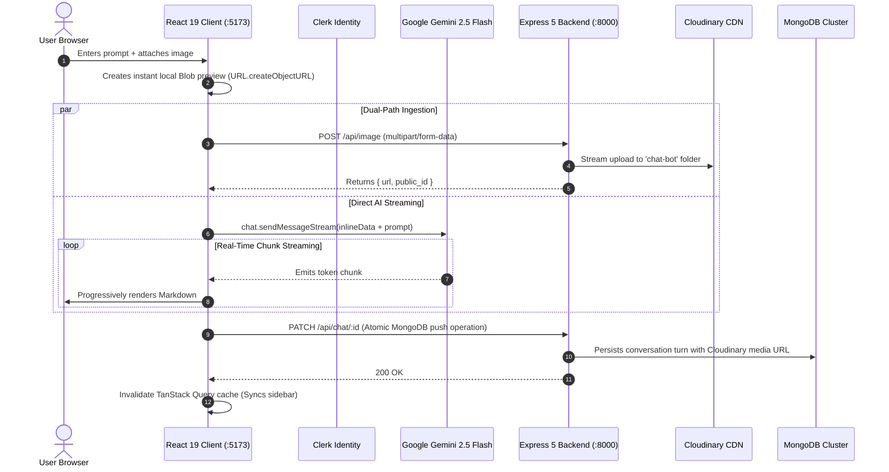

# Manga.ai — Full-Stack Multimodal AI Chatbot Platform

[](https://react.dev/)
[](https://expressjs.com/)
[](https://vitejs.dev/)
[](https://mongoosejs.com/)
[](https://ai.google.dev/)
[](https://clerk.com/)

A modern, production-structured conversational AI web application featuring **real-time token streaming**, **zero-latency multimodal image analysis**, **atomic conversation synchronization**, and **zero-trust identity verification**.

---

## 🏛️ System Architecture Overview



---

## 📂 Repository Structure

The project is architected as an isolated full-stack system with dedicated documentation for both tiers:

| Subsystem | Tech Stack | Documentation |
| :--- | :--- | :--- |
| **`Client/`** | React 19, Vite 7, TanStack Query v5, `@google/genai`, Clerk React, React Router 7 | **[Client Documentation ➔](./Client/README.md)** |
| **`Api/`** | Node.js (ESM), Express 5, Mongoose 8, Clerk Express, Cloudinary, Multer | **[Backend Service Documentation ➔](./Api/README.md)** |

---

## ⚡ Key Engineering Highlights

* **Dual-Path Multimodal Pipeline:** Eliminates cloud-upload wait times by directly piping Base64 `inlineData` to Gemini's vision engine while asynchronously persisting the binary file to Cloudinary in the background.
* **Non-Blocking Token Streaming:** Consumes asynchronous chunk streams (`for await...of`) to render tokens progressively without blocking the React 19 fiber reconciliation loop.
* **Document Partitioning (16MB BSON Protection):** Separates indexed directory metadata (`userChats`) from individual conversational records (`chat`) to guarantee `O(1)` history lookups and eliminate MongoDB 16MB document size caps.
* **Atomic Concurrency Control:** Employs MongoDB’s `$push` with `$each` to commit multi-turn conversations in a single round-trip without write-conflict locks.
* **Strict Mode Concurrency Guard:** Uses un-rendered reference sentinels (`useRef`) to protect against duplicate AI generations under React 19 Concurrent Mode lifecycle mounting.
* **Zero-Trust Identity Boundary:** Decoupled session verification via Clerk middleware at both edge ingress and database access layers.

---

## 🛠️ Quickstart

### Prerequisites
* **Node.js** $\ge$ v18.0.0
* **MongoDB** connection string
* **Clerk** application keys
* **Cloudinary** credentials
* **Google Gemini API** key

### 1. Backend Service Setup
```bash
cd Api
npm install

# Configure environment
cp .env.example .env # or create .env with required keys

# Run development server (Port 8000)
npm run dev
```

### 2. Frontend Client Setup
```bash
cd Client
npm install

# Configure environment
cp .env.example .env # or create .env with required keys

# Run Vite dev server (Port 5173)
npm run dev
```

---

## 📖 Deep Dives
* For API route specifications, Mongoose schemas, and server error handling, read **[`Api/README.md`](./Api/README.md)**.
* For streaming logic, TanStack Query caching strategy, and layout guards, read **[`Client/README.md`](./Client/README.md)**.
