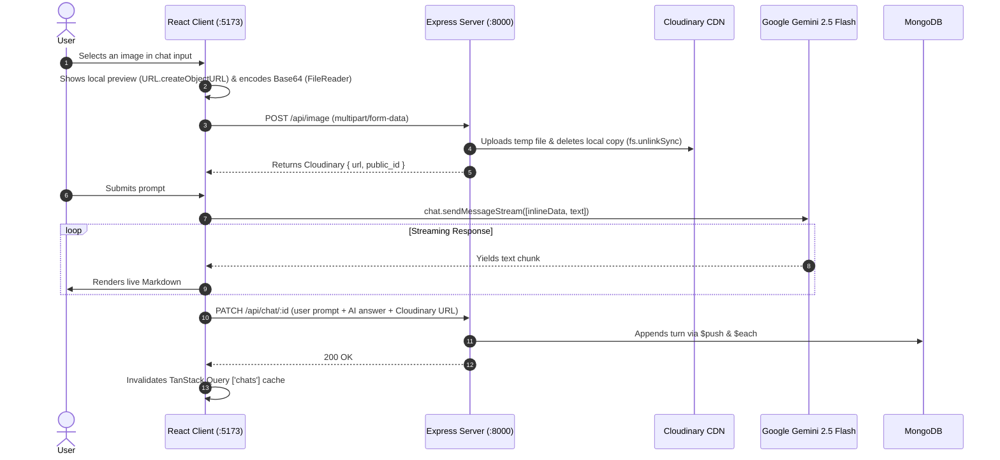

# Manga.ai — Full-Stack AI Chatbot

[](https://react.dev/)
[](https://expressjs.com/)
[](https://vitejs.dev/)
[](https://mongoosejs.com/)
[](https://ai.google.dev/)
[](https://clerk.com/)

A full-stack AI chatbot application built with **React 19**, **Express 5**, **MongoDB**, **Clerk**, **Cloudinary**, and **Google Gemini (`gemini-2.5-flash`)**. Users can sign in, start multi-turn conversations, upload images for visual Q&A, receive streamed Markdown responses in real time, and revisit their past chats from the sidebar.

---

## 🔄 End-to-End Application Flow



---

## 📂 Project Structure

This repository is split into two folders, each with its own detailed README:

| Folder | Tech Stack | Documentation |
| :--- | :--- | :--- |
| **[`Client/`](./Client)** | React 19, Vite 7, TanStack Query v5, `@google/genai`, Clerk React, React Router v7 | **[Read Client README ➔](./Client/README.md)** |
| **[`Api/`](./Api)** | Node.js (ESM), Express 5, Mongoose 8, `@clerk/express`, Cloudinary, Multer | **[Read Backend README ➔](./Api/README.md)** |

---

## ⚡ Key Features & Technical Choices

* **Real-Time Response Streaming:** Uses `@google/genai`'s `sendMessageStream()` with an async `for await...of` loop to progressively render Markdown (`react-markdown`) and auto-scroll as chunks arrive.
* **Multimodal Image Support:** Converts user-selected images into Base64 (`FileReader`) for Gemini's multimodal input while uploading the file via Multer to Cloudinary (`POST /api/image`) so the permanent image URL can be stored in MongoDB. Users can also remove an uploaded image before sending (`DELETE /api/image/:id`).
* **Two-Collection MongoDB Design:** Separates lightweight sidebar history (`userChats` storing `{ chat_id, title }`) from full conversation threads (`chat` storing `{ role, text, image }` arrays) so loading the sidebar doesn't fetch every message of every chat.
* **Direct Array Appends in MongoDB:** Uses Mongoose `findByIdAndUpdate` with `$push: { chat: { $each: body } }` to append new messages without reading and rewriting the entire conversation document.
* **Server State Management with TanStack Query:** Caches chat history (`["userChats"]`) and individual conversations (`["chats", id]`), automatically updating the UI via `invalidateQueries` after mutations.
* **Authentication with Clerk:** Protects `/dashboard` and `/chat/:id` routes on the frontend via `DashboardLayout` and identifies users on the backend via `@clerk/express` (`clerkMiddleware()` and `getAuth(req)`).

---

## 🛠️ Quickstart

### Prerequisites
* **Node.js** v18+
* **MongoDB** URI (local or MongoDB Atlas)
* **Clerk** Publishable & Secret keys
* **Cloudinary** Cloud Name, API Key & Secret
* **Google Gemini** API Key

### 1. Start the Backend (`Api/`)
```bash
cd Api
npm install

# Copy the example env file and fill in your keys
cp .env.example .env

# Start development server on http://localhost:8000
npm run dev
```

### 2. Start the Frontend (`Client/`)
```bash
cd Client
npm install

# Copy the example env file and fill in your keys
cp .env.example .env

# Start Vite dev server on http://localhost:5173
npm run dev
```
